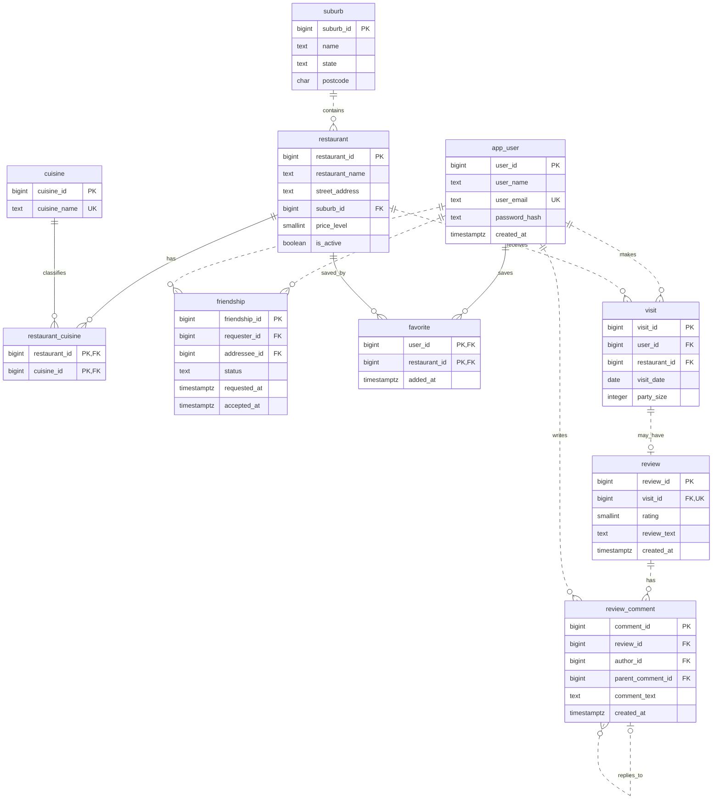

# Tablemates：A friends' Restaurant Review Database

Tablemates is a project built around friendship. It helps users discover restaurants through their friends’ preferences, specifically the feedbacks of visits where friends have recently eaten, including how they rated each visit, and restaurant details such as suburb, cuisine and price level.
Public review platforms aggregate the opinion of strangers, while friends' opinion stay scattered across chat histories. Tablemates stores friendships, visits and reviews as structured relational data. users register, manage friend requests, browse restaurants by suburb, cuisine, price, and ratings, record visists, write edit and delete reviews, save favorites, and discuss reviews in threaded comments.  
The database runs on PostgreSQL and is demonstrated through a Flask web prototype. ALL users, restaurants, reviews and comments are fictional. 

## 1. Environment and configuration

| Component | Requirement and purpose |
|---|---|
| Docker Desktop + Compose | Runs PostgreSQL 17 for the Docker setup (Sections 3.1–3.4); make sure Docker Desktop is running first |
| PostgreSQL (local install) | Only for the macOS one-click launcher (Section 3.0) |
| Python 3.11 or later | Runs Flask, the CSV generator and the import script |
| Python dependencies | Flask and psycopg, listed in `requirements.txt` |
| Git | Branching, reviewing changes, committing and pushing |
| Browser | Demo site at `http://127.0.0.1:5000/` by default (`5050` on macOS) |

Docker setup: database `friend_review`, user `friend_app`; only local port `127.0.0.1:5433` is mapped to the container's port `5432`.

The Docker commands below use **Windows CMD** and are run from the project root. macOS users, see the note at the end of Section 3.1. PowerShell uses a different syntax for environment variables.

| Setting | How to set it and what it does |
|---|---|
| `POSTGRES_PASSWORD` | Required; stored in the local `.env` file and read by both Compose and the Python connection |
| `DATABASE_URL` | Optional terminal environment variable; overrides the default database connection (set automatically by the macOS launcher) |
| `POSTGRES_HOST/PORT/DB/USER` | Optional terminal environment variables; defaults are localhost, 5433, friend_review and friend_app |
| `APP_HOST/APP_PORT` | Optional; defaults are 127.0.0.1 / 5000 |
| `APP_SECRET_KEY` | Optional; a fixed long random string keeps sign-in sessions valid across restarts |
| `FRONTEND_ORIGIN` | Optional; the exact origin of an HTTPS tunnel or separate frontend, without a path or trailing slash |
| `APP_HTTPS` | Optional; set to 1 for secure session cookies, only when the site is accessed over HTTPS |

Only the database password is read automatically from this project's `.env` file; set other variables in the same terminal that starts Python. `.env` is never committed to Git.

## 2. File structure

```text
friend-review-postgres/
├─ app/
│  ├─ api.py                    Registration, sign-in, queries, permissions and business endpoints
│  ├─ db.py                     PostgreSQL connection and reading the password from .env
│  ├─ templates/index.html      Page structure for sign-in/registration and the four main sections
│  └─ static/
│     ├─ app.js                 Frontend requests, filters, forms, comments and replies
│     └─ style.css              Evening theme; desktop and mobile layout
├─ data/                        10 UTF-8 CSV files: the project's only source of initial data
├─ scripts/
│  ├─ catalog.py                Hand-written fictional people, restaurants and review material
│  ├─ generate_data.py          Generates the CSV files; does not connect to the database
│  ├─ seed_data.py              Imports the CSVs in one transaction, creates password hashes, resets ID sequences
│  └─ check_project.py          Integration checks on a temporary database; can also serve an isolated browser test site
├─ sql/
│  ├─ init/
│  │  ├─ 01_schema.sql          10 tables, primary/foreign keys, unique and CHECK constraints
│  │  └─ 02_views.sql           Two-way accepted friends view and restaurant rating view
│  └─ demo_queries.sql          Report Section 4: queries, modifications, constraint and transaction demos (Parts A–D)
├─ docs/
│  ├─ conceptual-er.svg         Conceptual ER in lecture notation, shown directly in this README
│  ├─ conceptual-er.drawio      Editable diagrams.net source of the same ER
│  └─ current-schema.mmd        Mermaid relational schema of the 10 tables
├─ start-tablemates.command     macOS one-click launcher (no Docker needed)
├─ share-tablemates.command     macOS temporary public link (Cloudflare)
├─ compose.yaml                 PostgreSQL container and the v2 data volume
├─ requirements.txt             Python dependencies
├─ run.py                       Starts the website
├─ .env.example                 Database password template
├─ .gitignore                   Ignores environment files, caches and browser-test output
└─ README.md
```

## 3. Running from scratch

### 3.0 macOS one-click launcher (no Docker needed)

For Macs with PostgreSQL (Homebrew, Postgres.app or the EDB installer) and Python 3.11+ installed. Before the first use, make the launchers executable:

```bash
chmod +x start-tablemates.command share-tablemates.command
```

Then double-click `start-tablemates.command` in Finder (if macOS blocks it, right-click → **Open**). On the first run it starts PostgreSQL, creates the `friend_review` database with its tables and views, sets up `.venv`, imports the CSVs, and opens `http://127.0.0.1:5050/`. After that, double-clicking it starts the site directly. Keep the Terminal window open; press `Ctrl+C` to stop.

This setup uses your local PostgreSQL (port 5432). It is a separate database from the Docker setup (port 5433), and data is not shared between them. The launcher uses a fixed session key, so it is intended for local demos only.

### 3.1 Prepare Python and the password (Docker setup)

```cmd
cd friend-review-postgres
python --version
python -m venv .venv
.\.venv\Scripts\python.exe -m pip install -r requirements.txt
if not exist .env copy .env.example .env
notepad .env
```

Change `POSTGRES_PASSWORD` and save. If you already have a virtual environment and `.env`, use them as they are.

macOS users: in all commands, replace `.\.venv\Scripts\python.exe` with `.venv/bin/python`, and `copy` with `cp`. AirPlay occupies port 5000 on macOS, so start the website with `APP_PORT=5050 .venv/bin/python run.py` and open `http://127.0.0.1:5050/`.

### 3.2 Start the database and create the schema

Start Docker Desktop first, then run:

```cmd
docker compose up -d --wait
docker compose ps
```

`postgres` should show as `healthy`. The first time a new data volume starts, the two initialisation SQL files run. **This only creates the schema; it does not import the CSV data.**

### 3.3 Generate and import the data

The repository already contains the complete CSV files. Import them with:

```cmd
.\.venv\Scripts\python.exe scripts\seed_data.py
```

To regenerate visit records around a particular date, run the generator before importing:

```cmd
.\.venv\Scripts\python.exe scripts\generate_data.py --date 2026-10-14
```

The generator overwrites the 10 CSV files in `data/` and does not touch the database. The random seed is fixed at 9120, so the same date and code always produce the same data.

The importer only accepts a database with the current 10-table schema in which all base tables are empty. It imports in foreign-key order and locks the tables during the import; if any record fails, the whole batch is rolled back. Running it again on a non-empty database is refused, and existing data is kept.

The CSV users contain no passwords. The importer generates a separate salted bcrypt hash for each demo user; the default demo password is `DemoPass2026!`. After importing CSV records with explicit IDs, it resets the identity sequences, so newly registered users never collide with the initial IDs. Empty CSV cells mean SQL NULL, and postcodes are treated as text.

### 3.4 Start the website

```cmd
.\.venv\Scripts\python.exe run.py
```

Keep the terminal open and open [http://127.0.0.1:5000/](http://127.0.0.1:5000/). You can register a new account, or click **Enter demo** to use Alice:

```text
Email:    alice.morgan@example.test
Password: DemoPass2026!
```

`/api` is the JSON API entry point; the graphical pages are at `/`. To check the connection from another terminal:

```cmd
curl.exe http://127.0.0.1:5000/api/health
```

`{"database":"ok"}` means the connection works. Stop the website with `Ctrl+C`; stop the database with `docker compose down` (the data volume is kept). Next time you only need to start Docker and the website; **do not import again**.

Changes to the initialisation SQL or the CSVs do not update an existing database automatically. To restore the initial demo state, save any records you need first, then deliberately rebuild the current v2 volume: `docker compose down -v` **deletes all data** in the volume used by Compose. It is not a routine startup step and not a fix for password problems.

## 4. Initial data and the Alice demo

The initial data contains 100 users, 50 restaurants, 10 suburbs, 12 cuisines, 53 restaurant–cuisine links, 240 friendships, 300 favourites, 1,020 visits, 1,000 reviews and 246 comments/replies. 20 visits have not been reviewed yet.

All people, restaurants and English content are synthetic. Reviews are composed from hand-written scenarios, food names, service experiences and sentences matched to each rating. Food mentioned in a review is only part of its text; there is no dish table or dish rating.

Alice is always `user_id=1`:

| Demo action | Initial data |
|---|---|
| View friends' visits and reviews | Accepted friends Ben (2), Cara (3), Julian (10) |
| Accept a friend request | Henry (8) → Alice, request ID 4 |
| Reject a friend request | Ivy (9) → Alice, request ID 5 |
| Send a friend request | Search for Grace Wilson (7); no relationship yet |
| Edit or delete own review | Review IDs 1 and 4; the visit is kept after deletion |
| Comment and reply | Alice and Ben's conversation under reviews 1 and 2 |
| Add a review to an existing visit | Visit ID 1001, Corner Coffee |
| Save or remove a favourite | Restaurants 1, 3 and 5 already saved |

All actions are written to PostgreSQL, so the state changes after repeated demos. Newly registered users start with no friends, favourites or visits.

## 5. Features, API and database operations

| Feature | API | SQL / constraint focus |
|---|---|---|
| Register, sign in, sign out, current user | POST `/api/register`, `/api/login`, `/api/logout`; GET `/api/me` | INSERT; case-insensitive unique email; bcrypt |
| Suburbs and cuisines | GET `/api/catalog` | SELECT |
| Restaurant filtering and details | GET `/api/restaurants`, `/api/restaurants/{id}` | JOIN, EXISTS, filtering, sorting, AVG, COUNT |
| Restaurants friends visited recently | `/api/restaurants?friends_only=1&sort=friends` | Visits in the last 90 days; each friend counted once per restaurant |
| Which friends visited | GET `/api/restaurants/{id}/friend-visits` | JOIN, grouping, MAX |
| Find people, friendships | GET `/api/users?q=...`, `/api/friends` | Queries both directions and statuses |
| Send, accept, reject requests | POST `/api/friend-requests`, `/api/friend-requests/{id}/accept` or `/reject` | INSERT, UPDATE; no self-friendship; unique unordered friend pair |
| Save, remove favourites | GET/POST `/api/favorites`; DELETE `/api/favorites/{restaurant_id}` | Composite primary key, INSERT, DELETE |
| View reviews, friends-only filter | GET `/api/restaurants/{id}/reviews?friends_only=1`, `/api/reviews/{id}` | JOIN, friend subquery; all reviews visible |
| Visits, visit with review | GET `/api/me/visits`; POST `/api/visits` | Two INSERTs in one transaction |
| Add a review to an existing visit | POST `/api/visits/{id}/review` | Row lock; at most one review per visit |
| Edit, delete own review | PATCH/DELETE `/api/reviews/{id}` | UPDATE, DELETE, restricted to the owning user |
| Comments and replies | GET/POST `/api/reviews/{id}/comments` | INSERT; composite foreign key keeps replies on the same review |

Restaurant filter parameters: `q`, `suburb`, `cuisine`, `price_level` (1–4), `min_rating` (0–5), `friends_only` (0/1), `sort` (rating/reviews/name/price/friends). Lists support `limit` (at most 50) and `offset`. User input is passed as parameterised SQL; sort clauses are chosen only from a fixed whitelist.

Registration passwords must be at least 8 characters and at most 72 UTF-8 bytes, so bcrypt never silently truncates them. Review ratings are 1–5 and the text cannot be empty. Users without friends can still read reviews and comments; posting a comment requires signing in. Only the user who made the visit can edit or delete its review.

## 6. Transactions and verification

`POST /api/visits` inserts the visit first and then the review; both steps are in the same transaction. If the second step fails, the first is rolled back too. If only a visit is recorded, no review is inserted. The average rating is computed live by a view, so no restaurant field needs updating after a review is edited or deleted.

When a review is added to an existing visit, the visit row is locked, and the unique constraint on `review.visit_id` guarantees that concurrent requests produce only one review. Concurrent duplicates of registration emails and friend pairs are likewise handled by the database's unique constraints.

Deleting a review cascades to all its comments and replies; the visit is kept. A reply references `(review_id, comment_id)` through `(review_id, parent_comment_id)`, so a comment on a different review cannot be used as its parent.

[`sql/demo_queries.sql`](sql/demo_queries.sql) corresponds to Section 4 of the report and has four parts: A, queries (EXISTS, NOT EXISTS, CTE, HAVING, LEFT JOIN and aggregation); B, data modifications; C, 15 invalid operations rejected by constraints (each shown with its constraint name); D, multi-step transactions and rollback on failure. Every modification ends with ROLLBACK, so the script can be re-run and the row counts of every table are the same before and after:

```bash
docker compose exec -T postgres psql -U friend_app -d friend_review < sql/demo_queries.sql   # Docker setup
psql -d friend_review -f sql/demo_queries.sql                                                 # macOS launcher setup
```

To run the verification:

```cmd
.\.venv\Scripts\python.exe scripts\check_project.py
```

The verification script creates a randomly named temporary database, then checks import-failure rollback, repeat-import protection, registration, filtering, friend statuses, review permissions, comment relationships, cascade deletion and concurrency. At the end it deletes **only that temporary database**; the main demo database is never modified. The connecting account needs the CREATE DATABASE privilege, which the Docker default account has. For the macOS launcher setup, set `DATABASE_URL` first, e.g. `DATABASE_URL="postgresql://$USER@localhost:5432/friend_review"`.

For isolated testing in a browser:

```cmd
.\.venv\Scripts\python.exe scripts\check_project.py --serve
```

This serves a separate temporary demo site at [http://127.0.0.1:5001/](http://127.0.0.1:5001/); press Ctrl+C to stop it and remove its temporary database. Use port 5000 (5050 on macOS) for regular demos.

## 7. Conceptual ER and relational schema

### 7.1 Conceptual ER in lecture notation


[Open the full-size SVG](docs/conceptual-er.svg) · [Download/edit the draw.io source](docs/conceptual-er.drawio)

In diagrams.net, choose "Open Existing Diagram" and open `conceptual-er.drawio` to edit it. The SVG is the static export used by this README; after editing the source, export the SVG again. Mermaid's native `erDiagram` uses a different notation for relational schemas, so the SVG is used here to show the rectangles, diamonds, ellipses, thick and thin lines, and arrows exactly.

| Shape / line | Meaning |
|---|---|
| Rectangle, diamond, ellipse | Entity, relationship, attribute |
| Underlined attribute | The chosen entity key |
| Dashed ellipse | Derived attribute; average rating and review count are computed by a view |
| Thin line, no arrow | The entity can participate 0 to many times |
| Thin arrow, entity to relationship | The entity can participate 0 or 1 times |
| Thick line, no arrow | The entity must participate at least once, possibly many times |
| Thick arrow, entity to relationship | The entity must participate exactly once |

Thickness shows the participation constraint, and the arrow shows the key constraint, following the lecture examples.

The conceptual model has 8 entity sets, which map to the current 10 tables:

| Conceptual model | Implementation in the relational schema |
|---|---|
| User, Suburb, Cuisine, Restaurant | `app_user`, `suburb`, `cuisine`, `restaurant` |
| Friendship, Visit, Review, ReviewComment | `friendship`, `visit`, `review`, `review_comment` |
| Saves M:N relationship and its added_at attribute | `favorite(user_id, restaurant_id, added_at)` |
| ClassifiedAs M:N relationship | `restaurant_cuisine(restaurant_id, cuisine_id)` |

The diagram expresses foreign keys as relationships and does not repeat the foreign-key attributes. For example, Review relates to Visit through Reviews, and ReviewComment relates to its review, author and parent comment through HasComment, Writes and RepliesTo respectively.

Friendship's Requests and Receives relationships distinguish the requester from the addressee; every friendship has exactly one requester and one addressee. In RepliesTo, the reply end is a thin arrow, meaning a comment replies to at most one parent, and the parent end is a thin line, meaning a comment can have many replies. Visit to Reviews is a thin arrow, because a visit may not be reviewed yet; Review to Reviews is a thick arrow, because every review must belong to exactly one visit.

ClassifiedAs uses thin lines at both ends, following the current SQL, which allows a restaurant with no cuisine yet. Additional rules, such as case-insensitive unique emails and cuisine names, no self-friendship, friend-pair deduplication and replies staying on the same review, are defined by the SQL constraints.

### 7.2 Current 10-table relational schema

Source: [docs/current-schema.mmd](docs/current-schema.mmd). The same Mermaid content is embedded below so that GitHub and Mermaid-capable Markdown viewers render it. Update both places when the schema changes.

This is the implementation-level relational schema, with columns and primary/foreign keys, and complements the conceptual ER above. Solid lines are identifying relationships, where the parent key is part of the child table's primary key; dashed lines are non-identifying relationships; line ends show cardinality. `UK` on email and cuisine name means a case-insensitive uniqueness rule; composite unique constraints and CHECK constraints are defined in the SQL.



`accepted_friend` and `restaurant_rating_summary` are views, not base tables. The first expands accepted friendships into two-way friend pairs; the second aggregates all reviews, giving a NULL average and a count of 0 for restaurants without reviews.

## 8. Git branches and commits

Start new work from an up-to-date `main` on its own branch, with a clean working tree:

```bash
git switch main
git pull --ff-only origin main
git switch -c feature/your-feature
```

After making changes, check the diff and commit only the files you changed:

```bash
git status
git add <changed files>
git diff --cached
git commit -m "Describe the change"
git push -u origin feature/your-feature
```

Then open a Pull Request from the branch to `main` on GitHub. The CSVs are committed to Git so the data can be imported straight after cloning; after changing the generator or its material, check the CSV diff too. Data created later in the database (registrations, reviews and so on) stays in the Docker volume and is never uploaded with a commit. `.env`, `.venv` and browser-test output are ignored.

## 9. Troubleshooting

- **Port 5000 already in use (macOS):** macOS AirPlay Receiver uses this port. Start the site with `APP_PORT=5050`, or turn off AirPlay Receiver in System Settings.
- **A `.command` file won't open:** run `chmod +x *.command`, then right-click the file → Open.
- **Docker connection fails:** make sure Docker Desktop has started and shows the engine running; reopen the terminal if necessary.
- **The website has no data:** Docker only creates the schema automatically; you also need to run `seed_data.py` on the empty database.
- **The import says the database is not empty:** the database already has data, and the importer refuses to import again. For everyday use, just start the website.
- **The import says the schema does not match:** check whether you are still connected to the old 16-table database; the current Compose file should use the v2 volume.
- **The password is wrong after editing `.env`:** an existing PostgreSQL volume does not change its account password when the file changes.
- **The home page still shows the old version:** stop the old Flask process, then start the current `run.py`. Don't chain the Docker and Python commands on one line.
- **"This browser origin is not allowed":** when accessing the site through a cloudflared tunnel, set `FRONTEND_ORIGIN` to the tunnel URL in the same terminal before starting Flask, and set it again whenever the domain changes. The share script below does this automatically.
- **Temporary public link (macOS, optional):** double-click `share-tablemates.command`. The first time, it installs cloudflared with Homebrew; it then starts a copy of the site on port 5051, creates an `https://….trycloudflare.com` link and copies it to the clipboard. Closing the window stops sharing. Run `start-tablemates.command` at least once first. Anyone with the link can use the demo account to modify data, so share it only with the team and close it straight after use. The script assumes your local PostgreSQL lets the current Mac user sign in without a password; otherwise, set `DATABASE_URL` first.

This is a local course demo. The shared demo account can modify the demo data; when using a public tunnel, use only fictional content and close the tunnel after the demo.

## 10. Images, fonts and generative AI

- Restaurant photos come from Unsplash (Unsplash License). They are loaded by cuisine when viewed, are for presentation only, and are not stored in the database. Fonts are Jost and Manrope from Google Fonts. Both need an internet connection; offline, photos are hidden and fonts fall back, and all functionality still works.
- Generative AI use:  .
