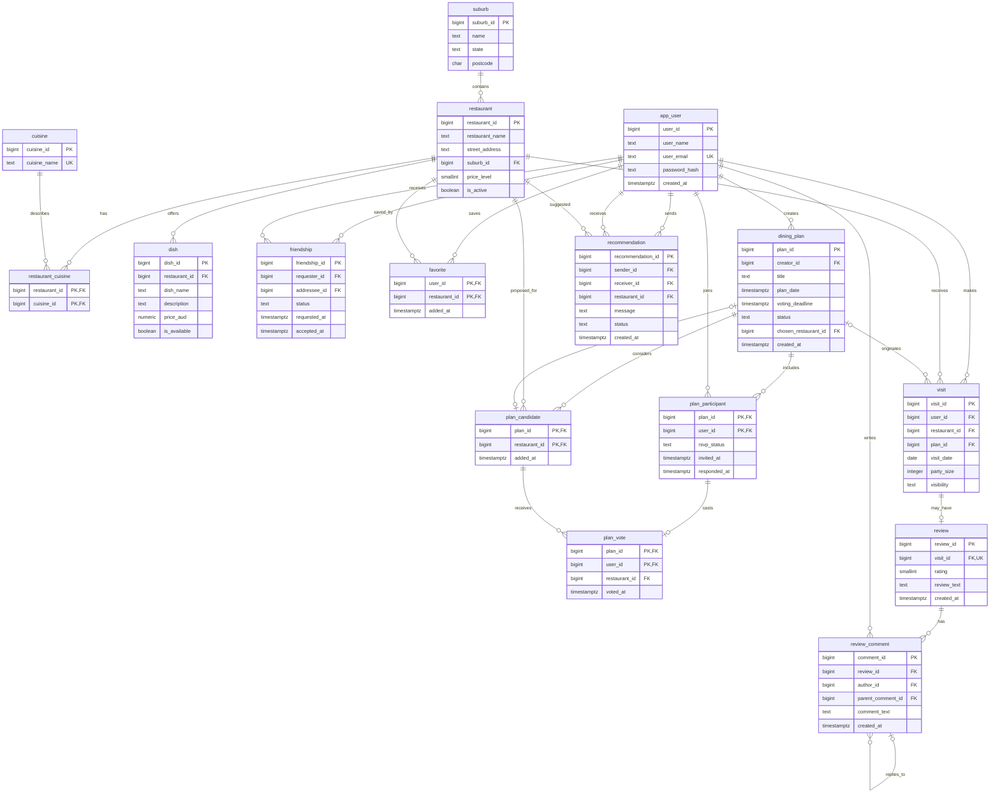

# Tablemates：好友餐厅点评系统

Tablemates 是一个课程项目演示站：用户可以寻找餐厅、记录到访并对**整家餐厅**评分，查看好友的分享、收藏店铺、互相推荐，以及发起聚餐计划和投票。前端及模拟内容使用英文；本说明使用中文。项目由 Flask 前端与 JSON API、PostgreSQL 数据库、Docker Compose 和可重复生成的模拟数据组成。

概念设计原稿见 小组 ER 图；**当前实现**以 [`sql/init/01_schema.sql`](sql/init/01_schema.sql) 为准，下文另有对应的 Mermaid ER 图。本项目与相邻的 `campus-booking-system` 无关。

## 1. 环境与端口

以下命令以 **Windows CMD** 为例（提示符通常形如 `D:\...>`），在项目根目录执行。不要把 CMD 的 `set ...` 与 PowerShell 的 `$env:...` 混用。

| 组件 | 要求 / 作用 |
|---|---|
| Docker Desktop + Compose | 启动 PostgreSQL 17 容器；执行命令前先确认 Docker Desktop 已运行 |
| Python | 3.11 或更新版本；运行数据生成器和 Flask |
| Python 依赖 | `requirements.txt` 中的 Flask、psycopg |
| Git | 创建分支、提交并推送；本目录已配置 `origin` 远端 |
| 浏览器 | 打开网站 `http://127.0.0.1:5000/` |

容器内数据库端口为 `5432`，仅映射到本机 `127.0.0.1:5433`；数据库名为 `friend_review`，用户为 `friend_app`。Flask 默认仅监听本机 `127.0.0.1:5000`。数据库密码放在本机 `.env`，**不要提交这个文件**。

常用配置如下。`POSTGRES_PASSWORD` 放在 `.env`，供 Compose 使用，应用也会从本目录读取它；其他运行期变量应在**启动 Flask 的同一个终端**设置，而不是以为写进 `.env` 就一定会生效。

| 变量 | 作用 |
|---|---|
| `POSTGRES_PASSWORD` | 必需；本地 PostgreSQL 的密码 |
| `DATABASE_URL` | 可选；覆盖应用默认的本机数据库连接参数 |
| `APP_HOST` / `APP_PORT` | 可选；默认 `127.0.0.1` / `5000` |
| `APP_SECRET_KEY` | 可选但建议设置为固定的随机长字符串；否则每次重启 Flask 都会使现有登录会话失效 |
| `FRONTEND_ORIGIN` | 跨来源前端或 HTTPS 隧道的**精确来源**，例如 `https://域名`，不含路径及末尾斜杠 |

## 2. 文件结构与作用

```text
friend-review-postgres/
├─ app/
│  ├─ api.py                   Flask 路由、登录、权限和业务接口
│  ├─ db.py                    PostgreSQL 连接及配置读取
│  ├─ templates/index.html     网站页面结构
│  └─ static/
│     ├─ app.js                前端请求、状态和交互
│     └─ style.css             页面样式与响应式布局
├─ scripts/
│  ├─ catalog.py               人工编写的英文姓名、餐厅、菜单等素材
│  └─ generate_data.py         根据素材生成可重复的批量模拟数据
├─ sql/init/
│  ├─ 01_schema.sql            16 张基本表、主外键、唯一约束和检查约束
│  ├─ 02_rules.sql             跨表业务规则的函数与触发器
│  ├─ 03_views.sql             好友、餐厅公开评分、投票统计视图
│  ├─ 04_seed.sql              基础样例与第一批演示记录
│  ├─ 05_generated_seed.sql    生成器输出的批量数据；新库初始化需要它
│  └─ 06_demo_user1.sql        Alice 的固定演示场景
├─ docs/current-schema.mmd     当前 SQL 结构的 Mermaid ER 图源码
├─ compose.yaml                PostgreSQL 容器、端口、数据卷和初始化挂载
├─ requirements.txt            Python 依赖
├─ run.py                      Flask 启动入口
├─ .env.example                本地数据库密码配置模板
├─ .gitignore                  忽略 .env、.venv 等本机文件
└─ README.md                   本说明
```

本地运行后还会有 `.env`、`.venv/` 和 Python 缓存。它们不属于项目源码。`05_generated_seed.sql` 虽由脚本生成，但**已经纳入 Git**，因为 Docker 首次初始化需要这份 SQL；修改生成逻辑后，应同时检查是否需要更新并提交它。

## 3. 从零运行：配置 → 模拟数据 → Docker → 网站

第一次在一台电脑上运行，请依次执行。若不是这个路径，替换第一行即可。

### 3.1 进入目录并准备 Python

```cmd
cd /d D:\python\9120_a1\friend-review-postgres
python --version
python -m venv .venv
.\.venv\Scripts\python.exe -m pip install -r requirements.txt
```

`python --version` 应显示 3.11 或更新版本。后续统一使用 `.venv` 里的 Python，不必激活虚拟环境。

### 3.2 配置数据库密码并生成模拟数据

```cmd
if not exist .env copy .env.example .env
notepad .env
.\.venv\Scripts\python.exe .\scripts\generate_data.py
```

在记事本中把 `.env` 的 `POSTGRES_PASSWORD` 改成你自己的本地密码并保存。不要把真实密码写入 README 或提交到 Git。生成器会**覆盖** `sql/init/05_generated_seed.sql`，使用固定随机种子，因此相同版本的素材与脚本会得到可重复的数据。它不需要额外的 Python 包。

### 3.3 启动 PostgreSQL

先启动 Docker Desktop，再执行：

```cmd
docker compose up -d --wait
docker compose ps
```

预期 `postgres` 显示为 `healthy`。在**全新数据卷第一次启动**时，Docker 按 `sql/init/` 的文件名顺序执行六个 SQL 文件：建表 → 规则 → 视图 → 基础数据 → 批量数据 → Alice 演示数据。

### 3.4 启动网站

```cmd
.\.venv\Scripts\python.exe .\run.py
```

保持此终端打开。在浏览器打开 [http://127.0.0.1:5000/](http://127.0.0.1:5000/)；点击 **Enter demo** 可直接用 Alice 演示账号进入。也可手动输入：

```text
Email:    alice.morgan@example.test
Password: DemoPass2026!
```

接口入口是 `http://127.0.0.1:5000/api`。另开 CMD 可检查数据库连接：

```cmd
curl.exe http://127.0.0.1:5000/api/health
```

正常返回 `{"database":"ok"}`。在运行 Flask 的终端按 `Ctrl+C` 可停止网站；`docker compose down` 可停止容器但**保留**数据库数据卷。之后用 `docker compose up -d --wait` 可继续使用原有数据。

> **注意：**修改 `01_schema.sql`、种子文件或重新运行生成器，不会自动更新已存在的数据卷。只有创建全新数据卷时，`sql/init/` 才会重新执行。**确实需要抹掉本项目数据库并重建**时，可在确认不需要旧数据后执行 `docker compose down -v`，再运行生成器和 `docker compose up -d --wait`；`-v` 删除的数据不可恢复。

## 4. 数据从哪里来

`catalog.py` 提供人工编写的英文虚构姓名、50 家餐厅的资料、菜品和描述；`generate_data.py` 将这些素材组合为到访、整店评价、留言和好友推荐，并写出 `05_generated_seed.sql`。评价文本根据评分和菜品素材组织为自然语言，但它们仍是**合成数据**，不是从真实点评网站采集的内容。

初始 SQL 中，`04_seed.sql` 放入基础数据；`05_generated_seed.sql` 将总规模扩展至 **100 个用户、50 家餐厅、250 道菜品、1000 条店铺 Review**；`06_demo_user1.sql` 为 `user_id=1` 的 Alice 补充固定场景，包括已接受好友、待同意/拒绝的申请、收藏、收发推荐与聚餐计划。Alice 可以在前端实际执行接受、拒绝和发出申请；操作会**持久写入数据库**，所以反复演示后状态可能与初始说明不同。

菜品 `dish` 仅供菜单展示。`review` 通过一次 `visit` 对**餐厅整体**评分，不存在单独的菜品评分或菜品评论表。评价文字可以提及吃过的菜，但不代表建立了菜品评价关系。

## 5. 已实现功能、API 与数据表

| 功能 | 主要 API | 主要表 / 视图及关系 |
|---|---|---|
| 登录、个人资料、首页统计 | `/api/login`、`/api/me`、`/api/dashboard` | `app_user` 保存加盐哈希密码；统计关联好友、收藏、到访、评价、推荐 |
| 餐厅搜索、菜系、菜单和公开评分 | `/api/catalog`、`/api/restaurants`、`/api/restaurants/{id}` | `restaurant → suburb`；`restaurant_cuisine` 连接餐厅与 `cuisine`；`dish → restaurant`；公开均分来自 `restaurant_rating_summary` |
| 好友申请、接受与拒绝 | `/api/users`、`/api/friends`、`/api/friend-requests` | `friendship` 保存请求两端和状态；`accepted_friend` 视图把已接受关系展开为双向好友 |
| 好友最近去过的店、只看好友评价 | `/api/restaurants?friends_only=1&sort=friends`、`/api/restaurants/{id}/friend-visits`、`/api/restaurants/{id}/reviews?friends_only=1` | 从 `accepted_friend` 找已接受好友，再查近 90 天的 `visit` / `review`；私人到访不展示 |
| 到访、整店评价、好友动态与回复 | `/api/visits`、`/api/restaurants/{id}/reviews`、`/api/feed`、`/api/reviews/{id}/comments` | `visit → restaurant` 和 `visit → app_user`；一次到访至多一条 `review`；`review_comment → review`，可回复另一条评论 |
| 收藏和个人到访记录 | `/api/favorites`、`/api/me/visits` | `favorite` 是用户与餐厅的多对多关系；到访历史来自 `visit` |
| 向好友推荐店铺 | `/api/recommendations` | `recommendation` 指向发送者、接收者和餐厅；只能向已接受的好友发送 |
| 聚餐计划、邀请、RSVP、投票、确定店铺 | `/api/plans`、`/api/plans/{id}` 及其 `/rsvp`、`/vote`、`/finalize` 等操作 | `dining_plan` 为计划；`plan_participant` 为参与者；`plan_candidate` 为候选餐厅；`plan_vote` 为一人一票；胜出餐厅必须在候选中 |

`visit.visibility` 分为 `public`、`friends`、`private`。公开评分视图只统计 `public` 的评价；好友动态允许已接受好友看到 `public` 或 `friends` 的评价；`private` 仅本人可见。数据库中的外键、唯一约束、检查约束和触发器与 API 检查共同保护这些业务规则。密码只以哈希存储；仓库内共享的 `DemoPass2026!` 仅用于虚构演示账号，不可用于真实用户。

## 6. 当前数据库 ER 图

图源码是 [`docs/current-schema.mmd`](docs/current-schema.mmd)。下面复制为 Mermaid 代码块，以便 GitHub 直接在 README 内渲染；Markdown 本身不能把另一个 `.mmd` 文件当作图形“引用进来”。修改数据库结构时，应同步更新 `.mmd` 与下面的代码块。**这张图依据当前 `01_schema.sql` 绘制；本次编写 README 时 Docker Desktop 未运行，因此没有对在线数据库再做一次系统目录核对。**



图只表达实体、字段和基数，不完全表达复合约束：`favorite`、`restaurant_cuisine`、`plan_participant`、`plan_candidate`、`plan_vote` 使用复合主键；`review.visit_id` 具有唯一约束；`dining_plan.(plan_id, chosen_restaurant_id)` 必须引用本计划的候选餐厅。`accepted_friend`、`restaurant_rating_summary`、`plan_vote_tally` 是**视图**，不是额外的基本表；更详细的限制与触发器见 `02_rules.sql` 和 `03_views.sql`。

## 7. Git：建分支、提交、推送

本目录已经是 Git 仓库，默认分支为 `main`，远端名为 `origin`。**当前 README 和 ER 图的修改若尚未提交，先在现有目录创建分支**，修改会随工作区进入新分支：

```cmd
git status
git switch -c docs/readme-er
git add README.md docs/current-schema.mmd
git diff --cached
git commit -m "docs: document setup and current ER diagram"
git push -u origin docs/readme-er
```

随后可在 GitHub 上从 `docs/readme-er` 向 `main` 发起 Pull Request。这里只提供命令，**不会自动创建分支或提交**。日后开始另一个任务，在工作区干净的前提下先同步主分支，再创建新的功能分支：

```cmd
git switch main
git pull --ff-only origin main
git switch -c feature/your-feature-name
```

提交前用 `git status`、`git diff` 和 `git diff --cached` 核对变更。`.env`、`.venv/`、缓存文件已被 `.gitignore` 忽略；不要用 `git add -f` 强行提交它们。若改动数据素材或生成逻辑，确认 `05_generated_seed.sql` 同步变化后再有选择地加入暂存区。Git 提交只保存文件，不会把你本机 Docker 数据卷中的后续交互记录上传。

## 8. 常见问题与演示边界

- **首页还是 JSON**：通常是旧版 `run.py` 仍占用 5000 端口；先停止旧 Flask，再启动当前代码。`/api` 本来就应返回 JSON，图形界面在 `/`。
- **Docker 命令找不到或连接失败**：重开终端并确认 Docker Desktop 已运行；若仍失败，检查 Docker Desktop 的安装与 PATH。
- **数据库密码错误**：`.env` 只在创建容器和连接应用时读取；修改现有 `.env` 不会改变已有 PostgreSQL 数据卷里的用户密码。不要用 `down -v` 当作无风险的修复手段。
- **`This browser origin is not allowed`**：若通过 cloudflared 等隧道访问，在**启动 Flask 的同一个 CMD 窗口**先设置 `set "FRONTEND_ORIGIN=https://你的隧道域名"`，然后重启 Flask；不要包含末尾 `/` 或路径。PowerShell 中对应语法为 `$env:FRONTEND_ORIGIN = 'https://你的隧道域名'`。隧道域名变化后要更新。
- **安全边界**：这是本地课程演示，不是生产部署。共享演示密码和一键登录意味着知道公开隧道链接的人可能修改演示数据；演示后应关闭隧道，不要放入真实个人资料或真实密码。
