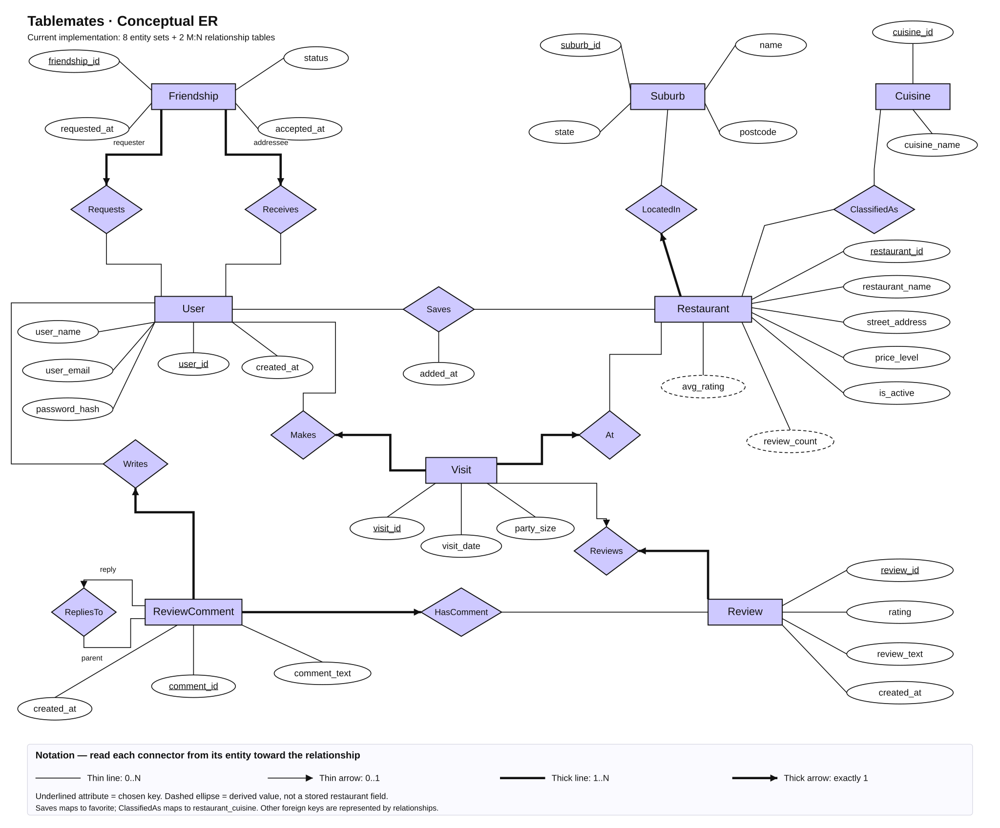
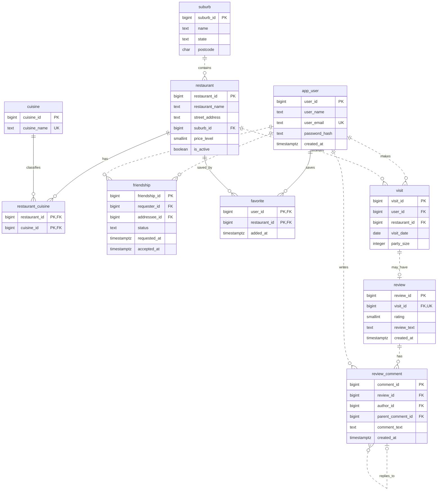

# Tablemates：好友餐厅点评数据库原型

本项目围绕“根据好友的到访和评价选择餐厅”，展示数据库的插入、筛选、修改、删除与事务。用户可以注册登录、管理好友、查看餐厅及好友评价、记录到访、编辑／删除本人评价、收藏餐厅，以及留言和回复。前端与虚构模拟数据使用英文，本说明使用中文。

当前范围为 **10 张基本表、2 个视图**。菜单、独立推荐收件箱、聚餐计划和投票已移除；评价统一可见，“只看好友评价”是查询筛选条件。课程提交仍需按任务书准备报告、视频和海报，README 是运行说明。

## 1. 环境与配置

| 组件 | 要求与作用 |
|---|---|
| Docker Desktop + Compose | 启动 PostgreSQL 17；执行命令前确保 Docker Desktop 已运行 |
| Python 3.11 或更新 | 运行 Flask、CSV 生成器与导入脚本 |
| Python 依赖 | `requirements.txt` 中的 Flask 和 psycopg |
| Git | 创建分支、查看差异、提交与推送 |
| 浏览器 | 正式演示站默认 `http://127.0.0.1:5000/` |

数据库：`friend_review`；用户：`friend_app`；仅映射本机 `127.0.0.1:5433` 到容器 `5432`。

以下命令使用 **Windows CMD**，在项目根目录执行。PowerShell 的环境变量语法与 CMD 不同，见最后的隧道说明。

| 配置 | 设置方式与用途 |
|---|---|
| `POSTGRES_PASSWORD` | 必需，放在本机 `.env`；Compose 和 Python 连接读取此项 |
| `DATABASE_URL` | 可选，终端环境变量；覆盖默认数据库连接 |
| `POSTGRES_HOST/PORT/DB/USER` | 可选，终端环境变量；默认分别为本机、5433、friend_review、friend_app |
| `APP_HOST/APP_PORT` | 可选，默认 127.0.0.1 / 5000 |
| `APP_SECRET_KEY` | 可选，固定随机长字符串可让登录会话跨重启保留 |
| `FRONTEND_ORIGIN` | 可选，HTTPS 隧道或独立前端的精确来源，不含路径与末尾斜杠 |
| `APP_HTTPS` | 可选，设为 1 使用 Secure 会话 Cookie；仅在通过 HTTPS 访问时设置 |

只有数据库密码会自动从本项目 `.env` 读取；其他变量在启动 Python 的同一终端设置。`.env` 不提交到 Git。

## 2. 文件结构与作用

```text
friend-review-postgres/
├─ app/
│  ├─ api.py                    注册、登录、查询、权限与业务接口
│  ├─ db.py                     PostgreSQL 连接及 .env 密码读取
│  ├─ templates/index.html      注册登录与四个主入口的页面结构
│  └─ static/
│     ├─ app.js                 前端请求、筛选、表单和留言回复
│     └─ style.css              桌面与手机样式
├─ data/                        10 个 UTF-8 CSV，项目唯一的初始数据源
│  ├─ users.csv                 用户，无明文密码或密码哈希字段
│  ├─ suburbs.csv               地区及邮编
│  ├─ cuisines.csv              菜系
│  ├─ restaurants.csv           餐厅地址与价格等级
│  ├─ restaurant_cuisines.csv   餐厅与菜系关联
│  ├─ friendships.csv           好友申请与关系状态
│  ├─ favorites.csv             用户收藏
│  ├─ visits.csv                到访记录
│  ├─ reviews.csv               整家餐厅的评分与评价
│  └─ review_comments.csv       留言与回复
├─ scripts/
│  ├─ catalog.py                人工编写的英文虚构人物、餐厅及评价素材
│  ├─ generate_data.py          生成 CSV；不连接数据库
│  ├─ seed_data.py              在一个事务内导入 CSV、生成密码哈希、调整自增序列
│  └─ check_project.py          临时数据库集成验证；也可启动隔离的浏览器测试站
├─ sql/
│  ├─ init/
│  │  ├─ 01_schema.sql          10 张表、主外键、唯一约束和检查约束
│  │  └─ 02_views.sql           双向已接受好友、餐厅评分统计视图
│  └─ demo_queries.sql          筛选、好友查询、聚合与事务 SQL 示例
├─ docs/
│  ├─ conceptual-er.svg         课堂符号概念 ER，README 直接显示
│  ├─ conceptual-er.drawio      同一概念 ER 的 diagrams.net 可编辑源文件
│  └─ current-schema.mmd        10 张表的 Mermaid 关系模式图
├─ compose.yaml                 PostgreSQL 容器及新的 v2 数据卷
├─ requirements.txt             Python 依赖
├─ run.py                       网站启动入口
├─ .env.example                 数据库密码模板
├─ .gitignore                   忽略环境、缓存和浏览器检查产物
└─ README.md
```

原来的三个种子 SQL 已由 CSV 替代；原有聚餐触发器文件已删除。现有核心规则可以由主外键、唯一约束和 CHECK 表达，不需要保留空的触发器文件。

## 3. 从零运行：Docker → CSV → 网站

### 3.1 准备 Python 与密码

```cmd
cd /d D:\python\9120_a1\friend-review-postgres
python --version
python -m venv .venv
.\.venv\Scripts\python.exe -m pip install -r requirements.txt
if not exist .env copy .env.example .env
notepad .env
```

修改 `POSTGRES_PASSWORD` 并保存。如果已有虚拟环境和 `.env`，直接使用即可。

### 3.2 启动数据库并建立结构

先启动 Docker Desktop，再执行：

```cmd
docker compose up -d --wait
docker compose ps
```

`postgres` 应显示 `healthy`。新数据卷首次启动时执行两个初始化 SQL，**此时只建立结构，没有自动导入 CSV**。

精简版使用 `friend-review-db_friend_review_pgdata_v2`。旧版 `friend-review-db_friend_review_pgdata` 不会被自动删除，也不会自动迁移到新结构。当前容器会改用 v2 卷。

### 3.3 生成并导入数据

仓库已经提供完整 CSV。要重新生成当前日期附近的到访记录，执行：

```cmd
.\.venv\Scripts\python.exe scripts\generate_data.py
.\.venv\Scripts\python.exe scripts\seed_data.py
```

生成器覆盖 `data/` 下的 10 个 CSV，不会修改数据库。固定随机种子为 9120；指定相同日期和相同代码可重复生成同一套数据：

```cmd
.\.venv\Scripts\python.exe scripts\generate_data.py --date 2026-10-14
```

导入器只接受当前 10 表结构且所有基本表为空的数据库。它按外键依赖顺序导入，导入期间锁住这些表，任何记录失败都会整批回滚；非空库重复导入会拒绝，保留已有数据。

CSV 用户不包含密码。导入器为每个演示用户分别生成加盐 bcrypt 哈希，默认演示密码为 `DemoPass2026!`。指定的 CSV ID 导入后会同步调整自增序列，因此新注册用户不会与初始 ID 冲突。CSV 空单元格表示 SQL NULL，邮编按文本处理。

### 3.4 启动网站

```cmd
.\.venv\Scripts\python.exe run.py
```

保持终端打开，访问 [http://127.0.0.1:5000/](http://127.0.0.1:5000/)。可以注册新账号，或点击 **Enter demo** 使用 Alice：

```text
Email:    alice.morgan@example.test
Password: DemoPass2026!
```

`/api` 为 JSON 接口入口，图形页面在 `/`。另开终端检查连接：

```cmd
curl.exe http://127.0.0.1:5000/api/health
```

返回 `{"database":"ok"}` 说明连接正常。停止网站用 `Ctrl+C`；停止数据库用 `docker compose down`，数据卷保留。下次只需启动 Docker 和网站，**不用重复导入**。

修改初始化 SQL 或 CSV 不会自动更新现有数据库。需要重新演示初始状态时，先保存需要的记录，再明确重建当前 v2 数据卷；`docker compose down -v` 会删除当前 Compose 使用的 v2 卷内全部数据。它不是日常启动或解决密码问题的步骤。

## 4. 初始数据与 Alice 展示流程

初始规模为 100 用户、50 餐厅、10 地区、12 菜系、53 条餐厅菜系关联、240 条好友关系、300 条收藏、1020 次到访、1000 条评价和 246 条留言／回复。20 次到访暂未评价。

所有人物、店铺和英文内容都是合成数据。评价由人工编写的场景、食物名称、服务体验和评分对应语句组合；提及食物只属于评价正文，没有菜品表或菜品评分。

Alice 固定为 `user_id=1`：

| 展示操作 | 初始数据 |
|---|---|
| 查看好友到访及评价 | 已接受好友 Ben（2）、Cara（3）、Julian（10） |
| 同意好友申请 | Henry（8）→ Alice，申请 ID 4 |
| 拒绝好友申请 | Ivy（9）→ Alice，申请 ID 5 |
| 发送好友申请 | 搜索 Grace Wilson（7），双方尚无关系 |
| 编辑／删除本人评价 | 评价 ID 1、4；删除后到访仍保留 |
| 留言与回复 | 评价 1、2 下有 Alice 与 Ben 的对话 |
| 为已有到访补评价 | 到访 ID 1001，Corner Coffee |
| 添加／取消收藏 | 已收藏餐厅 1、3、5 |

所有操作写入 PostgreSQL，反复演示后状态会变化。新注册用户从空的好友、收藏、到访记录开始。

## 5. 功能、API 与数据库操作

| 功能 | API | SQL / 约束重点 |
|---|---|---|
| 注册、登录、退出、当前用户 | POST `/api/register`、`/api/login`、`/api/logout`；GET `/api/me` | INSERT；邮箱不区分大小写唯一；bcrypt |
| 地区与菜系 | GET `/api/catalog` | SELECT |
| 餐厅筛选及详情 | GET `/api/restaurants`、`/api/restaurants/{id}` | JOIN、EXISTS、筛选、排序、AVG、COUNT |
| 好友近期去过的餐厅 | `/api/restaurants?friends_only=1&sort=friends` | 最近 90 天到访；每位好友每家店只计一次 |
| 哪些好友去过 | GET `/api/restaurants/{id}/friend-visits` | JOIN、分组、MAX |
| 找人、好友关系 | GET `/api/users?q=...`、`/api/friends` | 查询双方方向和状态 |
| 发出、接受、拒绝申请 | POST `/api/friend-requests`、`/api/friend-requests/{id}/accept` 或 `/reject` | INSERT、UPDATE；禁止自加；无向好友对唯一 |
| 收藏、取消收藏 | GET/POST `/api/favorites`；DELETE `/api/favorites/{restaurant_id}` | 复合主键、INSERT、DELETE |
| 查看评价与好友评价筛选 | GET `/api/restaurants/{id}/reviews?friends_only=1`、`/api/reviews/{id}` | JOIN、好友子查询；评价统一可见 |
| 到访记录、到访连同评价 | GET `/api/me/visits`；POST `/api/visits` | 两次 INSERT 在同一事务中 |
| 为已有到访补评价 | POST `/api/visits/{id}/review` | 行锁；一次到访至多一条评价 |
| 编辑、删除本人评价 | PATCH/DELETE `/api/reviews/{id}` | UPDATE、DELETE，按所属用户限制 |
| 留言与回复 | GET/POST `/api/reviews/{id}/comments` | INSERT；复合外键保证回复属于同一评价 |

餐厅筛选参数：`q`、`suburb`、`cuisine`、`price_level`（1–4）、`min_rating`（0–5）、`friends_only`（0/1）、`sort`（rating/reviews/name/price/friends）。列表支持 `limit`（最多 50）与 `offset`。用户输入使用参数化 SQL；排序片段只从固定白名单选择。

注册密码至少 8 个字符、最多 72 个 UTF-8 字节，避免 bcrypt 静默截断。评价评分为 1–5，正文非空。没有好友关系的用户也能查看评价和留言；发送留言需要登录。编辑／删除评价只允许其到访所属用户操作。

## 6. 事务与验证

`POST /api/visits` 可以先插入到访，再插入评价；两步位于同一事务。第二步失败时，第一步也回滚。若只记录到访，则不插入评价。评价均分由视图实时计算，修改／删除后不需要另行更新餐厅字段。

为已有到访补评价时锁定到访行，并用 `review.visit_id` 的唯一约束保证并发请求只能产生一条评价。注册邮箱和好友对的唯一约束同样由数据库处理并发重复。

删除评价会级联删除该评价下的全部留言及回复；到访记录保留。回复通过 `(review_id, parent_comment_id)` 引用 `(review_id, comment_id)`，不能把另一条评价的留言作为父留言。

查看 [代表性 SQL](sql/demo_queries.sql)。执行验证：

```cmd
.\.venv\Scripts\python.exe scripts\check_project.py
```

验证脚本创建随机命名的临时数据库，完成导入失败回滚、重复导入、注册、筛选、好友状态、评价权限、留言关系、级联删除及并发检查，最后删除**仅该临时库**。正式演示库不会被修改；连接账号需要 CREATE DATABASE 权限，Docker 默认账号具备该权限。

浏览器隔离验证可用：

```cmd
.\.venv\Scripts\python.exe scripts\check_project.py --serve
```

它在 [http://127.0.0.1:5001/](http://127.0.0.1:5001/) 提供独立的临时演示站；按 Ctrl+C 停止并清理临时库。日常演示使用 5000 端口。

## 7. 概念 ER 与关系模式

### 7.1 课堂符号概念 ER



[打开 SVG 大图](docs/conceptual-er.svg) · [下载／编辑 drawio 源文件](docs/conceptual-er.drawio)

在 diagrams.net 中选择“打开现有图表”，打开 `conceptual-er.drawio` 即可编辑。SVG 是 README 使用的静态导出；编辑源文件后应同步导出 SVG。Mermaid 原生 `erDiagram` 使用另一套关系模式符号，因此这里用 SVG 精确展示矩形、菱形、椭圆、粗细线和箭头。

| 图形／连线 | 含义 |
|---|---|
| 矩形、菱形、椭圆 | 实体、关系、属性 |
| 属性下划线 | 选定的实体键 |
| 虚线椭圆 | 派生属性；评分均值、评价数量由视图计算 |
| 细线，无箭头 | 该实体可参与 0 到多次 |
| 细箭头，实体指向关系 | 该实体可参与 0 或 1 次 |
| 粗线，无箭头 | 该实体必须参与至少 1 次，可多次 |
| 粗箭头，实体指向关系 | 该实体必须且只能参与 1 次 |

粗细表示参与约束，有无箭头表示键约束，读法与提供的示例一致。符号说明也可对照 [Berkeley CS186 的 ER 约束讲义，第 2 页](https://cs186berkeley.net/fa20/resources/static/notes/n13-DBDesign.pdf)。

概念模型有 8 类实体，映射后为当前的 10 张表：

| 概念模型 | 关系模式中的实现 |
|---|---|
| User、Suburb、Cuisine、Restaurant | `app_user`、`suburb`、`cuisine`、`restaurant` |
| Friendship、Visit、Review、ReviewComment | `friendship`、`visit`、`review`、`review_comment` |
| Saves 多对多关系及其 added_at 属性 | `favorite(user_id, restaurant_id, added_at)` |
| ClassifiedAs 多对多关系 | `restaurant_cuisine(restaurant_id, cuisine_id)` |

图中以关系表达外键，不再重复画出外键属性。例如 Review 通过 Reviews 关联 Visit；ReviewComment 通过 HasComment、Writes、RepliesTo 分别关联所属评价、作者和父留言。

Friendship 的 Requests、Receives 区分 requester 和 addressee；每条好友关系恰好有一个请求者和一个接收者。RepliesTo 中 reply 端是细箭头，表示一条留言最多回复一个父留言，parent 端是细线，表示可以被多条留言回复。Visit 到 Reviews 是细箭头，因为到访可以暂不评价；Review 到 Reviews 是粗箭头，因为每条评价必须属于一次到访。

ClassifiedAs 两端使用细线，遵循当前 SQL 允许餐厅尚未关联菜系的实现。邮箱／菜系名大小写不敏感唯一、禁止自己加好友、好友对去重、回复属于同一评价等附加规则仍以 SQL 约束为准。

### 7.2 当前 10 表关系模式

源码：[docs/current-schema.mmd](docs/current-schema.mmd)。下面嵌入相同 Mermaid 内容供 GitHub 和支持 Mermaid 的 Markdown 查看器渲染。更新结构时同时更新两处。

这是实现层的关系模式图，包含字段与主外键，与上面的概念 ER 配套使用。实线表示父键参与子表主键的识别关系，虚线表示非识别关系，端点表示基数。`UK` 对邮箱和菜系名称表示不区分大小写的唯一规则；复合唯一约束与 CHECK 以 SQL 为准。



`accepted_friend` 和 `restaurant_rating_summary` 是视图，不是基本表。前者将已接受关系展开为双向好友，后者统计所有评价；无评价餐厅的均分为 NULL、评论数为 0。

## 8. Git 分支与提交

先检查当前差异，然后创建分支；未提交的修改会进入新分支：

```cmd
git status
git switch -c feature/simplify-review-csv
git add app scripts sql docs data compose.yaml README.md .gitignore
git diff --cached
git commit -m "Simplify review prototype and import CSV seed data"
git push -u origin feature/simplify-review-csv
```

在 GitHub 从该分支向 `main` 发起 Pull Request。若分支已存在，使用 `git switch 分支名`。开始后续任务时，在工作区干净的前提下：

```cmd
git switch main
git pull --ff-only origin main
git switch -c feature/your-feature
```

CSV 纳入 Git，以便拿到项目即可导入。修改生成器或素材后同步检查 CSV 差异。数据库中后续注册、评价等数据保存在 Docker 卷内，不会随 Git 提交上传。`.env`、`.venv` 和浏览器检查产物被忽略。

## 9. 常见问题

- **Docker 连接失败**：确保 Docker Desktop 已启动并显示引擎运行，必要时重开终端。
- **网站没有数据**：Docker 只自动建结构；还需要在空库运行 `seed_data.py`。
- **导入提示非空**：数据库已经有数据，重复运行导入器会拒绝；日常启动直接运行网站即可。
- **导入提示结构不匹配**：检查是否仍连接旧 16 表数据库；当前 Compose 应使用 v2 卷。
- **修改 .env 后密码不正确**：已有 PostgreSQL 卷的账户密码不会随文件修改而自动改变。
- **首页仍是旧页面**：停止旧的 Flask 进程，再启动当前 `run.py`；不要在一行中拼接 Docker 和 Python 命令。
- **This browser origin is not allowed**：通过 cloudflared 访问时，在启动 Flask 的同一 CMD 终端先执行下面的命令，再启动网站。域名变化后重新设置：

```cmd
set "FRONTEND_ORIGIN=https://你的域名.trycloudflare.com"
.\.venv\Scripts\python.exe run.py
```

PowerShell 对应设置方式：

```powershell
$env:FRONTEND_ORIGIN = 'https://你的域名.trycloudflare.com'
.\.venv\Scripts\python.exe run.py
```

这是本地课程演示。共享演示账号可修改演示数据；公开隧道时只使用虚构内容，演示结束后关闭隧道。
